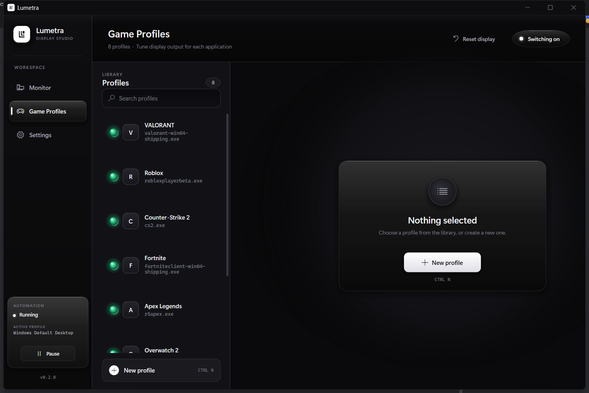
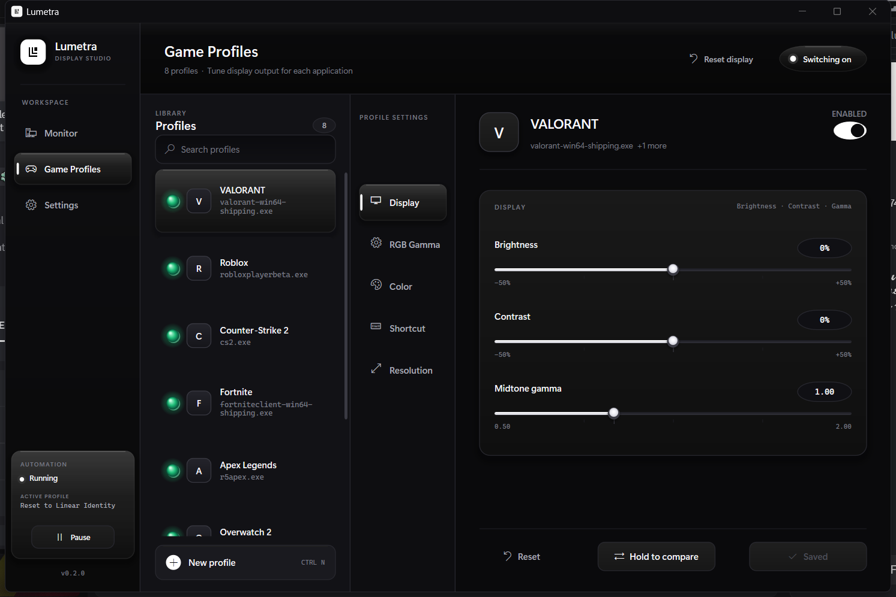

# Lumetra

Lumetra is a native Windows desktop utility for applying display profiles when a selected application becomes the foreground window. It also provides screenshot capture and optional per-game resolution profiles.

## Screenshots





## Features

- Switch display profiles based on the foreground application, with editable gamma, brightness, contrast, saturation, vibrance, and hue values.
- Restore the desktop baseline when no managed profile is active.
- Capture the active window or selected monitor scope with configurable global and per-profile hotkeys.
- Organize screenshots by profile and optionally copy captures to the clipboard.
- Save resolution profiles and choose automatic switching, confirmation before applying, or Off (the default).
- Choose between the Obsidian monochrome theme and the warm-light Paper theme.
- Manage the application from its settings window and system tray.

Some display effects depend on Windows/display support. Lumetra does not claim HDR color management or per-monitor gamma application. It does not inject code into other processes; users remain responsible for following the terms of the software they run.

## System requirements

- Windows 10 or Windows 11, x64.
- Visual Studio 2022 or newer with the Desktop development with C++ workload and Windows SDK.
- CMake 3.20 or newer. Ninja is required by the convenience `build.bat`; a Visual Studio generator can be used directly instead.

The application uses Windows APIs and SDK components including Win32, Direct2D, DirectWrite, and DXGI. No third-party package manager dependencies are currently declared in CMake. Lumetra's original project assets, including its icon, logo, and sounds, are owner-created and distributed under the project MIT license. Unrelated third-party materials retain their own terms and are not cleared by this permission.

## Build from source

From a Visual Studio Developer PowerShell with CMake and Ninja available:

```powershell
cmake -S . -B build -G Ninja -DCMAKE_BUILD_TYPE=Release
cmake --build build --config Release
ctest --test-dir build -C Release --output-on-failure
```

For a release build, set the canonical public GitHub identifiers with `-DLUMETRA_GITHUB_OWNER=YOUR_OWNER -DLUMETRA_GITHUB_REPO=YOUR_REPOSITORY`. They are empty by default, so update checks remain disabled until configured. See [update documentation](docs/UPDATES.md).

Or run `build.bat` from the project directory to locate Visual Studio's x64 toolchain, build a Release executable, and update the current user's Start Menu installation. Close Lumetra before running it so Windows can replace the installed executable.

The executable is `build\Lumetra.exe`. When building with CMake directly, install or refresh the current user's app and Start Menu shortcut with:

Close Lumetra before running this command so Windows can replace the installed executable.

```powershell
cmake --install build --prefix "$env:LOCALAPPDATA\Programs\Lumetra"
```

There is currently no signed installer. The update UI is download-only until the official repository and trusted publisher-signature verification are configured; downloaded files are not executed or installed by Lumetra.

## Data and privacy

Preferences are stored under the current user's `HKCU\Software\Lumetra\Preferences` key. Profiles are stored in the user's roaming application-data directory. Screenshots are saved to the configured folder (by default, the user's Pictures folder). See [Security](SECURITY.md) and [Screenshot documentation](docs/SCREENSHOTS.md).

## Contributing

Please read [CONTRIBUTING.md](CONTRIBUTING.md) before opening a pull request. Bug reports and feature requests can be opened through the repository's GitHub issue templates.
See [public launch steps](docs/PUBLICATION.md) for repository settings and release preparation.

## License

Lumetra's original source code and owner-created project assets (including `Icon.ico`, `Logo.jpg`, and the contents of `Sounds/`) are licensed under the [MIT License](LICENSE). This does not relicense unrelated third-party materials, which retain their own terms.

## Project layout

```text
src/       Application modules (app, detection, display, profiles, screenshots, UI, utilities)
cmake/     CMake helper scripts
docs/      User and contributor documentation
tests/     Automated tests
.github/   Issue templates and CI/security workflows
```
